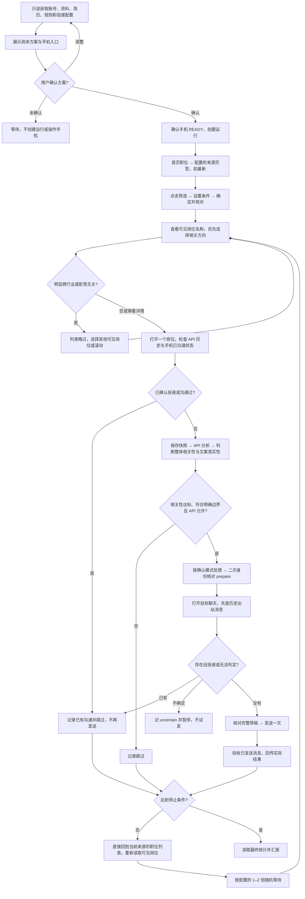

# BOSS 手机逐岗投递

## 适用边界

只在用户明确要求启动、继续、暂停或查看 BOSS 手机逐岗投递任务时使用。本 Skill 编排手机和 API，不修改旧网页自动投递任务、浏览器扩展状态或 `automation_runs`。

启动前需要：

- 具有 `agent:read` 与 `agent:run` 权限的 Agent Key。网页新生成的 `jsa_agent_v2_...` Key 内含**生成时**的 Job Search Assistant Base URL；使用 [地址解析脚本](scripts/resolve_agent_url.py) 从 Key 读取地址，不写死本机或线上域名，也不打印完整 Key。解析出的地址只用于连接该服务，随后调用 `/v1/agent/me` 验证 Key 与当前用户；验证失败时停止，不拿同一 Key 试探其他网址。
- 旧版 `jsa_agent_<prefix>_<secret>` Key 不含地址，必须由用户在当前对话中提供 Base URL，或从 `JSA_AGENT_BASE_URL` 环境变量取得；取不到就请用户提供地址或在网页生成新 Key，不能根据 Key 猜测域名。若服务迁址，新 Key 中旧地址不会自动改变，应让用户明确提供新地址或重新生成 Key。
- iPhone Use 服务 READY，手机已解锁且 BOSS 已登录。

- Key、验证码、密码和会话信息不得写入项目文件、长期日志或聊天总结。
- **Agent Key 只从两个来源获取**：① 用户在当前对话中明确提供；② 环境变量 `JSA_AGENT_KEY`。**不得扫描磁盘、会话记录、日志、剪贴板或任何本机文件来寻找 Key**，也不得把 Key 回显到对话里。解析脚本只输出地址；可从进程环境或标准输入读取 Key，不把 Key 放在命令行参数、文件或日志中。取不到就引导用户在“BOSS 手机逐岗投递”页面生成，不要代替用户创建网页登录身份。

调用接口时读取 [Agent API](references/agent-api.md)。

## 启动与授权

先只读调用 `/v1/agent/me`、`/v1/agent/context` 和 `/v1/agent/configs/default`，将接口返回的本次执行方案展示给用户，至少包含：

- 账号、配置名称与版本；来源页签及顺序、求职意向、关键词，以及计划在手机上采用的入口；
- 城市、薪资、经验、学历、公司规模、招聘者活跃度及其他非空筛选；未设置项明确为不限；
- 用于匹配和生成问候语的个人资料摘要、学历与经验、项目名称、选中简历名称及 ID、命中的适用规则；缺失或冲突的资料单独说明；
- 目标成功投递数、最大扫描数、匹配阈值、确认模式、问候语策略与是否发送简历附件。

必须等待用户对这份具体方案明确确认后，才可创建运行、开始手机导航/筛选或处理岗位。用户最初说“开始投递”“重新跑”、提供 Key 或异步问题的默认选项，都不能替代对已展示方案的确认。用户调整后先重新读取并展示最终方案；关键配置、资料或入口发生变化时重新确认，不能沿用旧方案的确认。

确认后的授权仅在该方案边界内有效：

- `automatic`：本次方案经确认后，符合规则的岗位可直接发送，直到停止条件成立，无须逐岗再确认。
- `per_job`：每个岗位发送前必须等待用户确认。

读取配置或预览岗位不构成发送授权。授权不扩展到修改简历、个人资料、筛选配置或旧任务。

## 手机入口与筛选

默认路径为 **BOSS 首页「职位」→ 配置的来源页签（如「最新」）→「筛选」→ 按已确认条件选择 →「确定」→ 当前列表逐岗处理**。`sourceTabs=["最新"]` 时直接点击首页的「最新」，不能用搜索结果里的「最新优先」代替。

- `jobIntentions` 是求职意向，不是搜索词。首页已有匹配意向时可切换；没有匹配项时保留当前意向并在执行前方案中说明，等待用户确定如何处理。不得自行创建/修改手机求职期望，或转为搜索流程。
- `keywords`、`jobIntentions` 或 API 的资料检索结果都不自动授权使用手机搜索。只有用户明确要求使用搜索，并确认具体搜索路径与关键词时，才能采用搜索流程。
- 来源页签切换后核对并应用当前配置的筛选。动态筛选优先按可见 label 定位；code 只作辅助。选择后检查选中状态，确认列表体现当前来源和筛选结果再处理岗位。
- **应用筛选后必须回看列表。** 若可见岗位为空，或清一色与已确认求职方向无关（跨行业、跨职业），先停止并向用户说明「按当前配置的筛选条件筛不出候选」，列出可能卡住候选的条件（例如薪资档、公司规模档），由用户决定放宽哪一项。**不得自行丢弃已确认的筛选项继续跑**，也不得在无候选时连续滚动消耗扫描配额。用户确认放宽后重新应用筛选并继续；用户未回应则暂停，不创建后续步骤。

## 选岗与相关性判断

以岗位方向和 JD 整体相关性为投递依据，不要求候选人逐条满足 JD 的全部描述、技能、年限或加分项。资料中未提及某项技能不等于不具备，也不单独构成拒投理由；问候语仍只能使用有证据的真实经历。

- **先看名称，再决定是否打开。** 每次选择下一岗前，先查看当前可见列表的岗位名称及可见摘要，优先选择与已确认求职方向相关的职位。明显跨行业、跨职业或主要职责无关的职位直接在列表略过，不必进入详情逐一分析。标题含糊但可能相关时再打开详情判断，不能机械地从上到下每个都点。
- **职位卡片只在安全区域内轻微变换点击点。** 先从当前控件树或截图确认目标卡片及其可点击正文区域；优先岗位标题附近、避开卡片边缘和收藏、沟通、更多等独立按钮。区域足够大且无浮层遮挡时，可在安全区域中心附近独立随机选一点，横纵偏移各不超过 `6` 个 iPhone 点；坐标必须是手机点而非截图像素。若边界、子按钮或坐标换算不确定，就用语义 selector 或安全中心点，不强行加入偏移。点击后读取打开的标题和公司，确认是所选岗位；若点错或未打开，先重新观察，不连续盲点。此规则只适用于打开列表职位卡片，不用于立即沟通、发送、确认、返回等关键按钮，也不保证能避免平台风控。
- **灵活选择相关岗位。** 根据职责判断 AI Agent、AI 应用、RAG、工作流、AI 产品，以及承担相关 AI 应用开发的全栈/FDE 等岗位；不要求标题完全匹配意向，也不要求每个技术关键词都一致。可以优先打开同屏中相关性更高的职位，再滚动寻找候选。
- **区分业务行业和岗位能力。** 公司服务医疗、金融、零售等行业，不代表它的通用 Agent/应用开发岗位跨行业；若核心工作实际是医疗影像算法、硬件控制、纯销售或其他与目标经历明显无关的专业方向，才按低相关性略过。不要只因为公司行业不同就拒投。
- **核心职责相关即可考虑投递。** JD 的主要工作与资料中的 Agent、RAG、Prompt、工作流、AI 应用或全栈项目有实质关联，整体相关性达到已确认阈值时，可以投递；个别工具、框架、细分行业经验和加分项的缺失不是否决项。不能沿用“任一明确要求缺少证据就跳过”的逐项全匹配标准。
- **保留明确边界。** 用户的禁投规则、已确认的筛选条件及明确不可协商且与真实资料冲突的限制仍需遵守；区分真实冲突与仅未提及，不把未证明每项能力当成真实冲突。不虚构技能、学历、年限或项目来提高相关性。
- **接口异常单独处理。** 若简历已有信息而 API 档案缺失，导致错误阻断，这是资料读取/判定问题，不得描述成候选人不合格，也不通过修改快照伪造条件来绕过。相关性判断不替代 API 发送状态校验；`shouldDeliver=false` 或 `prepare` 未返回 `opening_chat` 时仍不得直接发送。

列表略过的岗位不冒充已采集、已分析或已投递；已打开岗位仍按串行流程完成明确结果后才能打开下一个。保留真实列表位置，不把优先选岗后的处理顺序当成列表位置。

## 防重复沟通

**发送前必须同时检查服务端历史和 BOSS 手机端当前状态。** `jobs/check` 只覆盖当前账号里能匹配到同一 `platformJobId` 的既有记录；可见字段生成的指纹可能变化，旧流程或人工投递也未必在该接口中，`duplicate=false` 不能证明尚未投递。

1. 打开目标岗位后先调用 `jobs/check`；若返回 `duplicate=true`，本次不再采集、分析、打开聊天或发送，按接口已记录的跳过结果返回列表。
2. 在同一岗位详情页检查可见的「已沟通」「继续沟通」「已投递」等状态，并核对岗位、公司及招聘者。明确显示这个岗位已有沟通时，不发送；若 API 尚未记录，仍按状态机完成快照和分析，然后以 `skipped` 回传 `evidence.priorCommunication=true`、可见状态来源及“本次未发送”的原因。不能仅凭按钮写着「立即沟通」或接口未命中就认定是新会话。
3. 若详情页没有明确状态，`prepare` 通过后打开目标聊天，**先读当前会话和已有消息，再输入或点击任何问候语**。同一岗位/招聘者的历史出站消息、已投递卡片或已沟通记录一旦确认，立即停止本次发送；从 `opening_chat` 状态回传 `skipped`，证据标记 `priorCommunication=true`，不把旧消息记成本次成功投递。若打开聊天这一动作本身刚刚发送了消息，不再发送第二条；只在能确认该消息确属本次动作、收件人和全文时回传一次实际结果，否则记 `uncertain` 并暂停。
4. 无法判断历史消息是否对应当前岗位，或无法区分旧消息与本次新消息时，**不要试发一条来验证**；记录 `uncertain` 并暂停，请用户核对。只有确认目标会话没有既有投递或出站消息，才进入草稿输入与发送。无需把历史聊天全文写入证据；记录可见状态、岗位身份和判断依据即可。

## 流程图

## 串行执行

1. 完成上述方案确认并取得 iPhone Use READY 后，通过 Agent API 创建运行，保存 `run_id`。
2. 用 iPhone Use 打开 BOSS，按「手机入口与筛选」从首页进入 `sourceTabs` 指定的来源页签，再点击「筛选」应用已确认条件；只处理配置包含的页签，不自动追加其他来源或搜索。
3. 先按「选岗与相关性判断」查看当前可见岗位名称，略过明显跨行业/职责无关项，灵活优先选择相关候选；每次只打开一个岗位详情，采集标题、公司、完整 JD、薪资、经验、学历、公司规模、地点、技能、招聘者及活跃状态。公司名只取控件树中招聘者卡片「公司名 · 职位」对应的可见文本，标题只取详情页标题节点；控件树与截图不一致时以控件树为准，不自行补全工商全称。采集 JD 时先点击折叠的「查看全部」，再逐屏向上滚动读取懒渲染的控件树内容并去重拼接（建议最多 6 屏）；仍缺失的部分在 `snapshot.description` 末尾显式标注「（第 X 条未完整采集）」，禁止脑补。不要为取得岗位 ID 使用分享或复制链接；若详情页未显示原生 ID，以这些可见字段生成稳定的本次去重指纹，并在快照中标记 `identitySource=visible-fingerprint`。
   - **详情页滑动采集：**展开「查看全部」后，先读当前可见 JD，再在正文可滚动区域向上滑动一屏；每次滑动后等页面内容稳定、读取控件树，只追加新出现的职责、任职要求和公司信息。若滑动前后内容相同，先确认是否到达底部或加载中，不连续空滑；到达底部或已覆盖完整 JD 即停止。滑动避开屏幕边缘返回手势、聊天按钮和其他可点击控件；不随机改变滑动轨迹或频率来规避风控。
4. 携带岗位标识、来源和当前列表位置调用 `jobs/check`，并按「防重复沟通」检查 BOSS 当前岗位的已沟通状态。接口命中重复岗位时直接返回当前职位列表并选择下一岗；手机状态确认已沟通但接口未命中时，完成快照/分析后记录 `skipped`，不打开沟通或发送。从详情页返回列表后，列表可能刷新或顺序位移；必须重新读取当前可见列表，再确定下一个目标岗位及其**当前** `listPosition`，不得沿用进入详情前的序号。
5. 调用 `jobs/capture` 保存到本次步骤及 PC 端“职位快照”，再调用该步骤的 `analyze`。分析复用 PC 端的资料检索与问候语生成器；接口分数是资料检索相似度，结合完整 JD 判断主要职责和已有经历是否实质相关。整体相关性达标即可考虑投递，不逐项要求 JD 全匹配；仅因个别技能、工具、年限或加分项缺少证据而拒投不符合本流程。实际不相关、违反明确禁投边界，或问候语截断、不实、语病明显时记录具体原因并跳过。
   - **快照在 `capture` 后应视为待锁定，分析前完成字段核对；`analyze` 后即锁定，不能对同一步骤重跑 `capture/analyze`（返回 409）。** 因此第 3 步的采集应一次到位。若 `prepare` 因岗位身份不一致返回 409，不要尝试重采或重分析；记录 `failed`，在 `errorMessage` 写明不一致的字段和是否实际发送，再处理下一个岗位。
6. `shouldDeliver=false` 时记录 `skipped`，直接返回当前职位列表，再处理下一个岗位。
7. `shouldDeliver=true` 且问候语可用时，发送前再次读取同一详情页标题、公司与岗位标识，并复查已沟通状态。公司简称与去除常见法定后缀后的全称视为同名，不能因“股份有限公司”等后缀不同而重采已分析快照；若仍不一致，核对是否为另一家公司，不猜测或绕过。若 `confirmationMode=per_job`，先把标题、公司、分数、命中/风险及完整问候语展示给用户，取得本岗位明确确认后才调用 `jobs/{stepId}/prepare`，并传 `userConfirmed=true`；未确认不得打开沟通。`automatic` 模式可直接调用 prepare。API 返回 `opening_chat` 后：
   - 打开目标聊天，先核对聊天对象、岗位和历史消息；只有按「防重复沟通」确认本次没有重复发送风险，才准备问候语。若发现已有同岗出站消息，回传 `skipped` 和 `priorCommunication=true`，不要输入；无法确定则记 `uncertain` 并暂停。
   - **键盘已弹出即复用当前输入焦点。** 已确认在目标会话、键盘由当前聊天输入框唤起且无其他编辑框或弹窗遮挡时，按输入框已选中处理，直接无 selector 调用 `pua_type_text`，不因控件树没有 TextField/TextView 就反复定位、点击或重新唤起键盘。
   - **BOSS 聊天输入框可能是自定义控件。** 若 `pua_type_text` 明确返回 `no_focused_field` 且未输入，先看返回截图；画面确认键盘仍对应当前聊天框，就视为工具对焦点识别失败。不要反复点同一个框、原样重试，或直接跳到常用语；可用 WDA 输入通道（例如 `POST /wda/keys`，`{"value":[完整 greeting],"frequency":40}`）输入同一份 `greeting`。这是方案 ① 的等效输入方式，但结果证据应如实记 `inputMethod=wda_keys`，不能记为 `pua_type_text`；输入后必须读回完整草稿逐字核对。
   - 按 [iPhone 输入与回读](references/iphone-input.md) 依次尝试：① iPhone Use 输入完整 `greeting`，包含上述已聚焦自定义控件的 WDA 通道；部分输入先读回已有内容，只补缺失部分，不重放全文。② 已授权的 Mac→iPhone 通用剪贴板：仅在内存中暂存 Mac 原纯文本剪贴板，粘贴完整 `greeting`，手机回读后恢复原剪贴板；不要复制职位分享链接。**iOS 原生“粘贴”菜单通常需长按输入框；若当前控制通道没有长按能力或菜单不可见，此路不可达，不反复尝试，直接进入 ③。** ③ 核对 BOSS 第一条常用语的完整内容，仅在适用于当前岗位且没有不实或敏感信息时使用；否则记录 `failed`，不发送。手动输入或粘贴的草稿须从 AX 树精确读回；发送前仍无法核对则记 `failed`，仅发送动作结果不明时记 `uncertain`。
   - 发送前核对当前会话对应的招聘者/岗位以及完整文案。`pua_type_text` 与粘贴须读回输入框草稿；常用语须在点击前读清第一条全文，并确认选择它是填入草稿还是直接发送。若直接发送，只有上述核对完成后才点一次；不得为了测试发送或重复点击。
   - 发送后确认消息确实出现在当前会话；回传 `evidence.messageVisible=true`、`evidence.inputMethod`（`pua_type_text`、`wda_keys`、`universal_clipboard` 或 `first_common_phrase`）及 `evidence.sentText`（实际发送全文）。第一条常用语不等于 PC 端生成的 `greeting` 时，不得声称发送了生成文案；API 仍保留原生成文案供对照。
   - 若配置 `sendResume=true`，使用响应中的 `resumeId` 对应简历，在问候语确认发送后执行简历发送并核对聊天内简历卡片。回传 `resumeOutcome=sent` 与 `resumeVisible=true`；找不到可选简历填 `not_available`，操作明确失败填 `failed`，并在 `resumeError` 说明。不得换用其他简历。
8. 通过 `jobs/{stepId}/result` 回传结果；接口同步 PC 端职位快照跟进和投递记录。结果明确失败记录 `failed`；无法确认是否已经发送则记录 `uncertain`，不得自动重发。
9. 每个 result 使用稳定且唯一的 `idempotencyKey`。API 返回任务终态后立即停止；否则**直接回到当前来源的职位列表**，重新读取可见岗位并选择下一岗。投递后若停在聊天页，优先使用能直达列表的应用导航；若页面层级必须经过详情页，就连续完成必要的返回操作，只在到达列表后确认位置和刷新后的岗位，**不要在中途重新查看 JD、再打开同一岗位或重复“返回→查看→返回”**。跳过、失败或重复岗位也遵循同一列表落点。
   - `intervalSeconds` 是**两岗之间的等待下限**：每完成一个岗位并回到列表后，为本轮独立抽取 `waitSeconds ∈ [intervalSeconds, 2 × intervalSeconds]`，等待满这段时间再打开下一岗。例如配置 `1` 秒，本轮等待 `1–2` 秒；不要固定取端点、每轮复用同一值，或把采集/分析/API 耗时抵扣这段等待。页面尚未就绪时继续等待；任务终态、用户停止或出现风控时不再抽取或等待，而是立即停止并按“安全停止”处理。该间隔只调整处理节奏，不授权绕过验证码、风控或其他平台限制。

一个岗位形成明确结果前，不得打开下一个岗位或并行操作。

## 安全停止

出现以下任一情况立即暂停或结束并向用户说明：

- 登录失效、验证码、Face ID、密码或风控；
- 页面结构变化导致岗位身份无法核对；
- 发送结果不确定；
- Agent Key 失效或被撤销；
- 达到目标投递数、最大扫描数或 API 返回终态；
- 用户要求暂停或停止。

验证码、密码和 Face ID 由用户接管。不要猜测认证信息，不要绕过平台安全措施。

## 完成汇报

任务最终结束时，若运行仍为 `running` 或 `paused`，先调用 `POST /v1/agent/runs/{runId}/finish`（body 为 `{"status":"completed|stopped|failed|uncertain","reason":"..."}`）显式结束运行；若 API 已自动置为终态，不重复调用。用户只要求暂停时调用 `pause`，不调用 `finish`。再从 `GET /v1/agent/runs/{runId}` 读取最终统计，汇报任务状态、扫描/分析/符合/成功/跳过/失败/不确定数量及停止原因。未显式 finish 且未自动终止的运行会停留在 `running`。不要把“已分析”描述成“已投递”。
