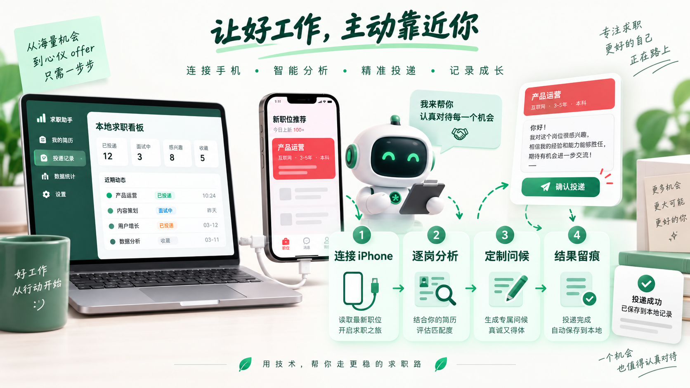
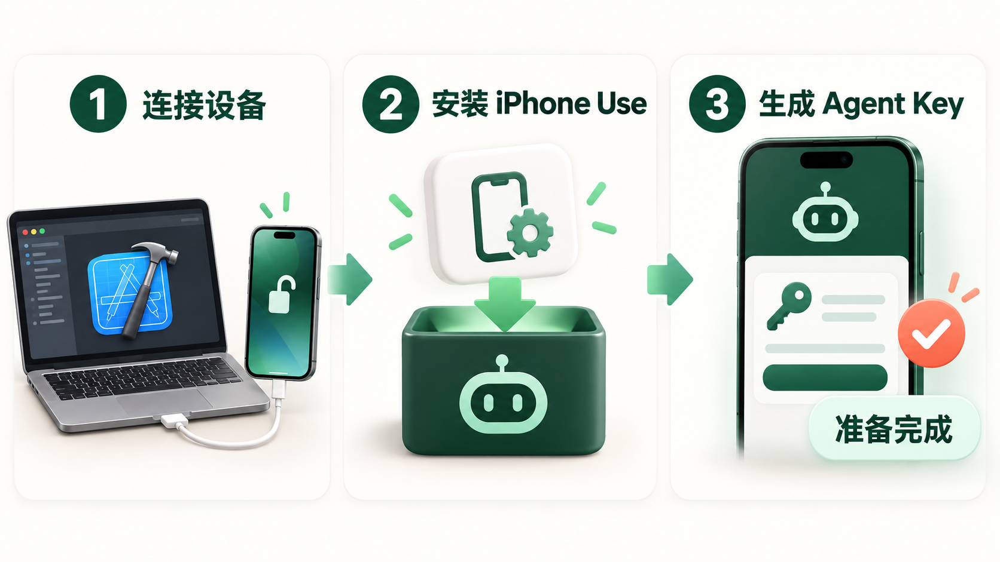

# BOSS 手机逐岗投递

这是一条面向求职者的手机投递流程。具备 Agent API 与 iPhone 操作能力的 AI 助手（下文以 Codex 为例）从你本人登录的 BOSS iPhone App 中读取当前可见的新岗位，每次只处理一个职位：先保存 JD，再结合你的档案、项目和所选简历判断是否符合，符合时使用与 PC 端相同的生成能力准备问候语，发送后把实际结果写回 Job Search Assistant。

它不会替换原来的网页自动投递，也不会修改已有网页任务。两条流程可以保留在同一套系统里，但不要在同一时间对同一个 BOSS 账号执行投递。



## 这条流程适合谁

如果你更在意下面这些事情，可以选择手机精准投递：

- 希望查看 BOSS 手机端“推荐、附近、最新”里的更新岗位；
- 不想只看一个笼统分数，而是逐项核对学历、经验和技术硬要求；
- 希望问候语真正结合自己的档案、项目和指定简历；
- 希望一个岗位处理完再看下一个，避免重复沟通或串错职位；
- 希望在 Job Search Assistant 中看到职位快照、判断理由、实际发送文案和任务进度。

如果你要一次采集较多岗位，再在网页上集中确认企业清单，请继续使用 README 中原有的网页自动投递流程。

## 开始前准备



你需要准备：

1. 一台 Mac，并安装完成完整 Xcode。只有 Command Line Tools 不够。
2. 一部通过 USB 连接的真实 iPhone。手机需要信任这台 Mac、开启系统要求的开发者模式，并在安装和操作期间保持解锁。
3. iPhone 上已登录自己的 BOSS 账号。
4. 本机可用的 Codex 或其他兼容 AI 助手，以及 Python 3.9+、符合 iPhone Use 要求的 Node.js 和 npm。
5. 已启动的 Job Search Assistant，并在“个人档案、项目库、简历库”中保存真实资料。

Apple 账号登录、设备信任、开发者模式、密码、验证码和 Face ID 都由你本人完成。AI 助手不应询问或代为输入这些敏感信息。

## 第一步：安装 iPhone Use

iPhone Use 负责让兼容的 AI 助手通过 USB 读取和操作你的真实 iPhone。项目地址：

<https://github.com/zhongerxin/iPhone-use>

以 Codex 为例，可以把下面这段话发给本机助手：

```text
请帮我安装和配置 iPhone Use：
https://github.com/zhongerxin/iPhone-use

请先检查完整 Xcode、Python、Node.js、npm 和通过 USB 连接的 iPhone，
再按照项目 README 运行安装脚本。安装后配置我自己的设备和 Apple 开发团队，
直到 iPhone Use 显示 READY。需要 Apple 登录、信任、开发者模式或解锁时让我接管。
不要照搬作者的设备标识或签名信息。
```

也可以手动执行：

```bash
git clone https://github.com/zhongerxin/iPhone-use.git
cd iPhone-use
sh scripts/install.sh
```

安装完成后通常需要重新连接或新开一个 Codex 会话。随后告诉 Codex：

```text
用 iphone-use-setup 配置这部 USB iPhone，复用已有配置，
启动并验证 READY，然后显示手机屏幕。
```

只有 iPhone Use 明确返回 READY 后，才继续下面的投递流程。详细依赖和故障排查以 [iPhone Use 官方 README](https://github.com/zhongerxin/iPhone-use#readme)为准。

## 第二步：准备 AI 助手（Codex 可安装项目 Skill）

本仓库提供了可独立安装的 [`boss-codex-delivery` Skill](../.agents/skills/boss-codex-delivery/SKILL.md)。Codex 用户可用它读取配置、逐岗分析、控制 iPhone、验证发送结果以及安全停止。`boss-codex-delivery` 是保留兼容性的安装标识，不是网页功能仅限 Codex 的意思；其他助手无需安装 Codex Skill，但必须具备相应的 [Agent API 契约](../.agents/skills/boss-codex-delivery/references/agent-api.md)和 iPhone 操作能力。

让其他用户安装时，可把下面的话发给 Codex：

```text
请从下面的 GitHub 路径安装 boss-codex-delivery Skill：
https://github.com/a764506248/Job-Search-Assistant/tree/main/.agents/skills/boss-codex-delivery

安装完成后告诉我，并从下一轮开始使用这个 Skill。
```

Skill 安装后会在下一轮对话可用。它只负责编排新增的手机流程，不会启动或修改旧网页自动投递任务。

## 第三步：在网页保存自己的投递计划

1. 打开正式站点 [https://jsazhushou.cn/](https://jsazhushou.cn/) 并登录；使用本地部署时则打开 `http://127.0.0.1:8765`。两者数据独立，选择保存了本人资料的站点。
2. 先检查“个人档案、项目库、简历库”，确保内容真实、最新。
3. 打开左侧“BOSS 手机逐岗投递”。
4. 在页面顶部生成 Agent Key，并立即复制保存。完整 Key 只显示一次；新生成的 Key 会携带当前页面使用的服务地址，因此助手无需猜测本地或线上域名。
5. 保存手机筛选和投递计划：
   - 来源：推荐、附近、最新；
   - 城市、关键词、求职意向；
   - 薪资、经验、学历、公司规模、行业、福利、融资阶段；
   - BOSS 活跃状态和推荐标签；
   - 目标投递数、最大扫描数和岗位间隔下限（每岗实际等待下限的 1–2 倍）；
   - 最低资料相似度、最低问候语置信度；
   - 本次要使用的简历，以及是否随沟通发送简历；
   - 自动投递或每岗确认。
6. 第一次真实使用把目标投递数设为 `1`，确认整个闭环正确后再逐步增加。

Agent Key 用于你选择的 AI 助手调用当前登录用户的 Agent API。它不是 BOSS 密码，但仍然属于敏感凭据：不要提交到 Git、截图公开或写进 Skill 文件；不再使用时在页面中撤销。旧版 Key 不含服务地址，使用时需要另行告知助手 Base URL，或在网页生成新 Key。服务迁址后，新 Key 内的旧地址也不会自动更新，需要重新生成 Key 或明确提供新地址。

正式站点的手机投递页面是 [https://jsazhushou.cn/codex-delivery](https://jsazhushou.cn/codex-delivery)，Agent Base URL 为 `https://jsazhushou.cn`，接口前缀为 `https://jsazhushou.cn/v1/agent`。在正式域名下生成新版 Key 才会携带该域名；文档地址不覆盖 Key 内地址，也不允许拿同一个 Key 试探其他服务。本机 iPhone Use 继续通过 USB 操作手机，业务数据通过 HTTPS 写回线上后台。

## 第四步：让 AI 助手开始逐岗处理

确认手机已解锁、BOSS 已登录、iPhone Use 为 READY 后，以 Codex 为例发出类似请求：

```text
使用 boss-codex-delivery 和 iPhone Use，读取我的默认 BOSS 手机逐岗投递配置。
先向我确认来源、筛选条件、所选简历和目标投递数，再开始逐岗处理。
使用我本次提供的 Agent Key；不要修改旧网页自动投递任务。
```

随后把网页刚生成的 Agent Key 只提供给本次任务。兼容的 AI 助手会按保存的计划执行：

```text
进入 BOSS 的推荐 / 附近 / 最新
→ 打开一个岗位并读取完整 JD
→ 保存职位快照
→ 用个人档案、项目和所选简历逐项判断
→ 不符合：记录原因，处理下一个
→ 符合：生成并核对定制问候语
→ 再次核对岗位和公司
→ 发送问候语，并按计划处理简历
→ 验证聊天中的实际结果
→ 写回职位快照、实际文案和进度
→ 回到列表后，在设定间隔的 1–2 倍范围内等待，再处理下一个
```

在“每岗确认”模式下，AI 助手会在真正打开沟通前，把岗位、公司、分数、风险和完整问候语给你确认。没有得到本岗位确认时不能发送。

## 系统如何判断是否投递

系统不会因为“资料相似度高”就直接认定岗位合适。它会同时检查：

- JD 中明确要求的学历、经验和技术能力是否有真实资料支撑；
- 当前岗位标题和公司是否与采集快照一致；
- 是否已经沟通过，避免重复发送；
- 问候语是否完整、自然，是否包含未经证实的经历；
- 资料相似度和问候语置信度是否达到你保存的阈值；
- 手机端最终是否真的出现已发送消息。

任何明确硬条件缺少证据、岗位身份不一致、文案截断或结果无法确认时，都不会记作成功投递。

## 问候语输入与结果记录

AI 助手按下面的顺序尝试把 PC 端生成的完整问候语输入 BOSS：

1. 优先使用 iPhone Use 的文字输入能力；
2. 输入控件不兼容时，尝试 Mac 到 iPhone 的通用剪贴板；
3. 前两种都失败时，才检查 BOSS 第一条常用语是否适用于当前岗位。

发送前会核对完整草稿和目标会话；发送后必须看到聊天中的消息，才会记录为成功。职位快照中保存的是手机实际发送的文案和输入方式。如果启用了发送简历，还会单独记录简历已发送、失败或不可用。

## 什么时候会暂停

遇到以下情况，流程会停止或等待你接管：

- BOSS 需要重新登录、验证码或出现风控；
- iPhone 锁屏、断开 USB 或 iPhone Use 不再 READY；
- 岗位详情结构变化，无法确认标题或公司；
- 无法确认消息是否真的发送；
- Agent Key 失效、过期或已撤销；
- 达到目标投递数或最大扫描数；
- 你要求暂停或停止。

结果不确定时不要立即重发，以免对同一招聘者发送两次。

## 在哪里查看结果

回到管理后台的“BOSS 手机逐岗投递”，可以看到：

- 当前任务状态和目标进度；
- 已扫描、已采集、已分析、符合、跳过、失败和待确认数量；
- 每个职位的快照、判断理由和生成问候语；
- 手机实际发送文案、输入方式和简历发送结果；
- 任务停止原因。

职位还会出现在“职位快照”中，成功沟通时同步更新沟通状态。旧网页自动投递的任务和记录仍按原来的流程展示。

## 安全建议

- 首次试投只设置 1 个岗位。
- 个人档案和简历只写真实经历，不要让模型补造技能。
- 不要把 Agent Key、BOSS 登录信息或手机设备信息提交到仓库。
- 不要同时启动网页投递和手机投递。
- 如果使用公共电脑，完成后撤销 Agent Key，并退出 BOSS 和管理后台。

需要了解产品需求和技术边界时，再阅读 [PRD](codex-delivery/PRD.md) 与[技术架构](codex-delivery/TECHNICAL_ARCHITECTURE.md)；普通使用不需要理解这些研发文档。
