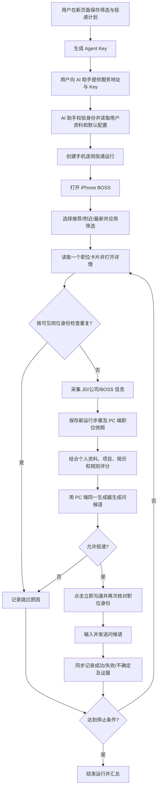

# BOSS 手机逐岗投递 PRD

## 1. 文档信息

- 功能名称：BOSS 手机逐岗投递
- 触发端：兼容 Agent API 与 iPhone 操作能力的 AI 助手（Codex + iPhone Use 为示例）
- 执行端：用户本机 iPhone 上的 BOSS 直聘
- 数据端：Job Search Assistant 本地服务
- 核心约束：只新增独立链路，不改变现有“网页自动投递”流程、表、状态机和浏览器扩展协议

## 2. 背景与目标

现有自动投递由网页创建任务，浏览器扩展批量采集职位，本地分析后再执行投递。新流程由兼容的 AI 助手发起，复用当前用户已经维护的个人档案、项目、简历、匹配规则和模型配置，并通过 iPhone 上的 BOSS 直聘逐个查看、分析和投递岗位。

本功能的目标是：

1. 用户在一个新页面中维护仅供手机逐岗投递使用的筛选条件和投递计划。
2. 页面生成可撤销、可过期、最小权限的 Agent Key，供所选 AI 助手获取当前用户的数据。
3. AI 助手按“读取一个岗位、记录快照、分析一个岗位、决定一个岗位、执行或跳过”的方式串行处理。
4. 用户可以持续看到岗位快照、评分、问候语、决策原因、投递结果和任务进度。
5. 达到计划中的成功投递数量、扫描上限或安全停止条件后结束任务。

## 3. 非目标

- 不替换、不重构现有网页自动投递流程。
- 不复用现有 `automation_runs` 作为新任务状态表。
- 不修改浏览器扩展的现有采集和执行协议。
- Agent Key 不保存 BOSS 密码、验证码、Cookie 或手机解锁信息。
- 首期不支持多个岗位并行操作，也不在结果不确定时自动重发。
- 首期不承诺 BOSS 页面结构永久稳定；页面变化应进入“需要人工处理”状态。

## 4. 用户角色与场景

### 4.1 求职用户

用户已在 Job Search Assistant 中维护个人档案、项目经历、简历、风险规则和模型配置，希望通过所选 AI 助手下达一次手机投递任务，并随时查看过程。

### 4.2 AI 助手（Codex 为示例）

AI 助手从新版 Agent Key 读取生成时的服务地址，再用 Key 验证身份；旧版 Key 则由用户另行提供服务地址：

- 读取当前用户及投递配置；
- 创建独立运行记录；
- 操作已经登录的 iPhone BOSS；
- 提交岗位快照并请求分析；
- 按分析结果投递或跳过；
- 回传每一步结果。

## 5. 完整业务流程

执行必须严格串行。只有上一个岗位形成明确结果后，才允许处理下一个岗位。

## 6. 页面需求

新增独立路由“BOSS 手机逐岗投递”（内部路径仍为 `/codex-delivery`），不得改变现有“自动投递”页面行为。

### 6.1 连接设置

- 展示当前服务地址，区分本机地址与远程 HTTPS 地址。
- 创建 Agent Key；明文只在创建时显示一次。
- 展示 Key 名称、前缀、权限、创建时间、最近使用时间、过期时间和撤销状态。
- 支持撤销 Key。
- 安全提示：`http://127.0.0.1:*` 仅供同机访问；公网地址必须使用 HTTPS。

Agent Key 是身份凭证，新版 Key 仅额外编码生成时的服务地址，不编码个人信息。服务端根据完整 Key 的哈希查找 `user_id`，再读取该用户数据；地址并非独立的服务身份凭据，助手连接后仍须调用 `/v1/agent/me` 验证。

### 6.2 手机筛选条件

根据实际 BOSS iPhone 页面，首期支持：

| 字段 | 形式 | 示例/说明 |
| --- | --- | --- |
| 来源页签 | 多选、有顺序 | 推荐、附近、最新 |
| 求职意向 | 多选 | 使用个人档案中已维护的意向 |
| 搜索关键词 | 多值 | 职位名、技术栈等 |
| 城市 | 单选 | 名称与平台编码同时保存 |
| 工作经验 | 多选 | 1年以内、1-3年、3-5年等 |
| 学历 | 多选 | 大专、本科、硕士等 |
| 公司规模 | 多选 | 0-20人、20-99人等 |
| BOSS 活跃 | 单选 | 全部、今日活跃、3日内、本周、本月 |
| 薪资 | 单选或自定义区间 | 15K以下、15-25K等 |
| 福利待遇 | 多选 | 周末双休、五险一金等 |
| 融资阶段 | 多选 | 未融资、A轮、已上市等 |
| 行业 | 多选 | 保存标签和可用的平台编码 |
| 推荐标签 | 多选 | BOSS 动态返回的个性化标签 |

动态选项必须同时保存展示名称和平台编码（若可取得），不能只硬编码编码。

### 6.3 投递计划

- 目标成功投递数，默认 1。
- 最大扫描职位数，必须大于等于目标投递数。
- 岗位处理间隔下限；手机逐岗流程在每岗完成并返回列表后，独立抽取下限至两倍下限之间的等待时间。
- 最低匹配分。
- 最低问候语定制置信度。
- 使用的简历。
- 是否在沟通后发送简历。
- 问候语策略与兜底问候语。
- 确认模式：自动执行或每岗确认（首期可先实现自动执行配置保存，由 Codex 按配置执行）。
- 结果不确定时是否立即停止，默认开启。

### 6.4 进度与岗位明细

运行列表展示：状态、当前阶段、当前来源页签、目标数、已扫描、已采集、已分析、符合、成功、跳过、失败、不确定、停止原因和时间。

岗位步骤展示：岗位、公司、来源、列表位置、快照、评分、命中规则、决策原因、问候语、当前动作、最终结果、证据和错误信息。

## 7. 匹配与投递决策

分析输入包括：

- 本次岗位快照；
- 当前用户个人档案；
- 求职意向；
- 项目和知识库素材；
- 选定简历；
- 匹配和风险规则；
- 当前配置的阈值。

分析输出至少包括：

- `score`：0-100；
- `should_deliver`：是否建议投递；
- `decision_reasons`：可读理由；
- `matched_rules`：命中的规则；
- `greeting`：针对该岗位的问候语；
- `greeting_confidence`：定制置信度；
- `risk_flags`：风险标记。

硬性拒绝规则优先于分数。缺少关键 JD、岗位身份不一致、疑似重复投递或问候语置信度不足时，不允许自动发送。

## 8. 状态定义

### 8.1 运行状态

`created -> running -> completed | paused | stopped | failed | uncertain`

### 8.2 单岗位状态

`discovered -> captured -> analyzed -> eligible | rejected -> opening_chat -> sending -> delivered | skipped | failed | uncertain`

`delivered` 只能在页面出现可验证的已发送结果后写入。无法确认是否发送时必须写入 `uncertain`，并在默认策略下停止整次运行。

## 9. 停止条件

满足任一条件即停止：

- 成功投递数达到计划值；
- 扫描职位数达到上限；
- 当前筛选结果耗尽；
- 用户主动暂停/停止；
- 登录失效、验证码、风控或身份不确定；
- 投递结果不确定且配置要求停止；
- 服务端授权失效或 Key 被撤销；
- 连续错误达到安全阈值。

## 10. 安全、隐私与幂等

- 数据默认只保存在用户现有服务中。
- Key 仅保存 SHA-256/HMAC 等不可逆摘要和可识别前缀；明文不落库。
- Key 至少区分 `agent:read`、`agent:run` 权限，并支持过期和撤销。
- 日志和 API 响应不得回显完整 Key。
- `user_id + platform + platform_job_id` 用于重复岗位检查。
- 每个投递步骤携带唯一 `idempotency_key`；同一 Key 重试不得产生第二次发送记录。
- Agent API 不接受来自请求体的任意 `user_id`，用户身份只从 Key 推导。

## 11. 兼容性边界

- 新表统一使用 `codex_` 或 `agent_` 前缀。
- 新 API 统一使用 `/v1/agent` 与 `/v1/codex-delivery` 命名空间。
- 新页面使用独立路由和类型文件。
- 不修改旧任务的创建、确认、runner claim、浏览器 action 和进度字段含义。
- 可以只读复用现有个人档案、项目、简历、规则和模型配置。
- 若需要复用匹配或问候语逻辑，应抽取无副作用服务或在新服务中调用，不能写入旧运行状态。

## 12. 验收标准

1. 用户能创建配置、保存上述筛选项与投递计划，并设置默认配置。
2. 用户能创建和撤销 Agent Key，创建时仅显示一次明文。
3. 有效 Key 能读取当前用户信息和默认配置；无效、过期或撤销 Key 返回 401/403。
4. Codex 能创建独立运行，逐个写入快照、分析结果和投递结果。
5. 重复的岗位/幂等请求不会导致重复投递记录。
6. 进度统计与岗位步骤一致，达到停止条件后状态正确。
7. 新功能的测试和页面操作不改变旧 `automation_runs` 数据。
8. 前端通过类型检查和生产构建；部署后新路由存在目标 Ant Design DOM，并真实完成一次选择、保存或 Key 弹窗交互。
