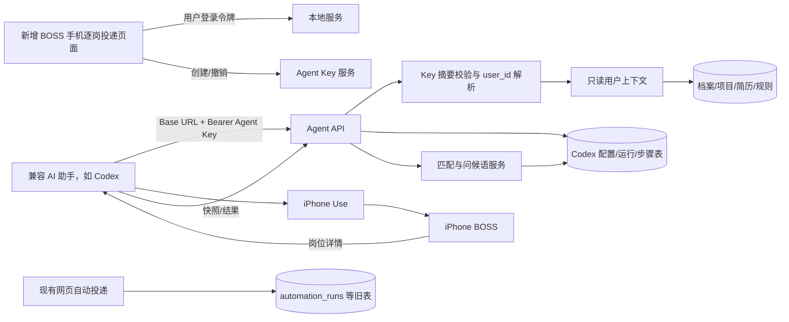
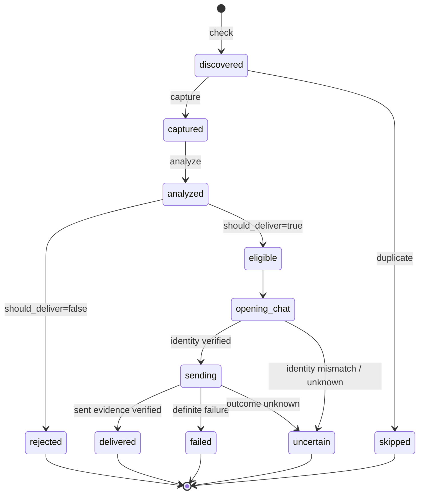

# BOSS 手机逐岗投递技术架构

## 1. 架构原则

本功能采用“共享用户资料，隔离运行状态”的旁路架构：只读复用现有档案、项目、简历、规则和模型能力；新增认证、配置、运行和岗位步骤模块；不把手机流程接入旧网页自动投递状态机。

`OLD` 与 `AGENT` 不互相触发，不共享运行记录，也不更新彼此的进度。

## 2. 模块划分

整体职责分为三层：页面提供配置和可观察性，API 提供受控的数据与状态能力，项目 Skill 作为 Codex 的逐岗编排示例；其他助手可按同一 API 契约与 iPhone 操作能力执行。执行步骤不硬编码进后端 runner。

新增后端包 `job_search_assistant/codex_delivery/`：

- `models.py`：Pydantic 请求/响应模型和状态枚举。
- `repository.py`：四张新表、Agent Key 摘要校验、事务、统计和幂等处理。
- `router.py`：网页管理 API、Agent API、用户上下文组装和分析协调。

前端新增：

- `views/codex-delivery/CodexDeliveryView.vue`
- `types/codex-delivery.ts`
- API client 中只增加独立方法，不改变旧自动投递方法签名。

Codex 新增项目 Skill：

- `.agents/skills/boss-codex-delivery/SKILL.md`：授权边界、串行流程、安全停止和结果汇报。
- `references/agent-api.md`：Agent API 的调用顺序与载荷。

## 3. 数据模型

### 3.1 `agent_api_keys`

| 字段 | 类型/约束 | 说明 |
| --- | --- | --- |
| id | PK | Key 记录 ID |
| user_id | NOT NULL | 从网页登录用户取得 |
| name | NOT NULL | Key 名称 |
| key_prefix | UNIQUE | 展示和快速定位用前缀 |
| key_hash | UNIQUE | 完整 Key 的不可逆摘要 |
| scopes_json | JSON text | `agent:read`, `agent:run` |
| expires_at | nullable | 过期时间 |
| last_used_at | nullable | 最近使用时间 |
| revoked_at | nullable | 撤销时间 |
| created_at | NOT NULL | 创建时间 |

新版 Key 形式为 `jsa_agent_v2_<Base URL 的 base64url 无填充编码>_<prefix>_<secret>`；服务端使用安全随机数生成密钥，只在创建响应中返回一次，数据库保存**完整 Key**的摘要。地址由网页创建 Key 时提供，服务端规范化后编码；任何地址字段篡改都会让完整 Key 摘要不匹配。旧客户端不传地址时仍生成兼容的 `jsa_agent_<prefix>_<secret>`，旧 Key 无法反推出地址。服务迁址后需重新生成 Key，或由用户明确提供新 Base URL。

### 3.2 `codex_delivery_configs`

配置是可复用模板，关键字段如下：

- 标识：`id, user_id, name, is_default, enabled, version`。
- 来源：`source_tabs_json, job_intentions_json, keywords_json, city_code, city_name`。
- 筛选：`experience_json, degree_json, company_scale_json, boss_activity`。
- 薪资：`salary_mode, salary_code, salary_min_k, salary_max_k`。
- 动态筛选：`benefits_json, financing_json, industries_json, recommended_tags_json`。
- 计划：`target_delivery_count, max_scan_count, interval_seconds`。
- 决策：`minimum_score, minimum_customization_confidence`。
- 材料：`resume_id, send_resume, greeting_strategy, fallback_greeting`。
- 安全：`confirmation_mode, stop_on_uncertain`。
- 审计：`created_at, updated_at`。

所有平台选项统一存为 `{ "code": "...", "label": "..." }` 数组；无编码的动态标签允许只有 `label`。

### 3.3 `codex_delivery_runs`

运行创建时保存 `config_snapshot_json`，避免用户修改配置影响已开始任务。

主要字段：`id, user_id, config_id, trigger_source, status, current_stage, current_source_tab, current_job_id, target_delivery_count, scanned_count, captured_count, analyzed_count, eligible_count, delivered_count, skipped_count, failed_count, uncertain_count, stop_reason, started_at, finished_at, created_at, updated_at`。

### 3.4 `codex_delivery_job_steps`

每个岗位一条状态主记录：

`id, user_id, run_id, snapshot_id, platform, platform_job_id, source_tab, list_position, score, greeting_confidence, should_deliver, decision_reasons_json, matched_rules_json, risk_flags_json, greeting, resume_id, status, current_action, idempotency_key, result_json, evidence_json, error_message, created_at, updated_at`。

对 `(run_id, platform_job_id)` 和 `idempotency_key` 建唯一约束。岗位详情必须同时写入新步骤的 `snapshot_json` 与现有 `job_postings` 职位快照，后者标记 `source=codex-phone`、使用独立命名空间的岗位标识，避免覆盖旧采集记录；步骤中的 `pcSnapshotId` 可定位 PC 端记录。iPhone 页面未给出原生岗位 ID 时，使用标题、公司、招聘者、地点、薪资等屏幕可见字段形成稳定去重指纹，不调用分享或复制链接。

分析使用现有 `CloudGreetingGenerator` 与 PC 端相同的 `job/profile/localEvidence/defaultGreeting/match` 上下文。新流程把学历、Linux 经验等资格差距及分数/定制置信度未达阈值记录到 `risk_flags_json`，不再据此强制将 `should_deliver` 改为 `false`；用户明确设置的禁投规则仍可拒投，岗位身份、去重和发送证据守卫保持不变。风险不得被表述为已满足资格，也不能用于编造问候语。结果接口将新步骤的结果同步至 `delivery_records`，确认发送时更新对应职位快照的沟通状态。旧 `automation_runs` 的协议和数据不变。

## 4. API 设计

### 4.1 网页管理 API

使用现有网页登录鉴权：

| 方法 | 路径 | 用途 |
| --- | --- | --- |
| GET | `/v1/codex-delivery/configs` | 配置列表 |
| POST | `/v1/codex-delivery/configs` | 创建配置 |
| PUT | `/v1/codex-delivery/configs/{id}` | 更新配置 |
| DELETE | `/v1/codex-delivery/configs/{id}` | 删除未被运行引用的配置 |
| GET | `/v1/codex-delivery/runs` | 运行和进度列表 |
| GET | `/v1/codex-delivery/runs/{id}` | 运行详情与岗位步骤 |
| GET | `/v1/agent-keys` | Key 元数据列表 |
| POST | `/v1/agent-keys` | 创建 Key，唯一一次返回明文 |
| DELETE | `/v1/agent-keys/{id}` | 撤销 Key |

### 4.2 Agent API

使用 `Authorization: Bearer <Agent Key>`，身份只从 Key 解析：

| 方法 | 路径 | 权限 | 用途 |
| --- | --- | --- | --- |
| GET | `/v1/agent/me` | `agent:read` | 当前用户摘要与能力 |
| GET | `/v1/agent/context` | `agent:read` | 档案、项目、简历、规则摘要 |
| GET | `/v1/agent/configs/default` | `agent:read` | 默认投递配置 |
| POST | `/v1/agent/runs` | `agent:run` | 创建运行并冻结配置快照 |
| GET | `/v1/agent/runs/{id}` | `agent:read` | 获取进度及下一步 |
| POST | `/v1/agent/runs/{id}/jobs/check` | `agent:run` | 重复检查/登记发现 |
| POST | `/v1/agent/runs/{id}/jobs/capture` | `agent:run` | 保存详情快照 |
| POST | `/v1/agent/runs/{id}/jobs/{step_id}/analyze` | `agent:run` | 分析并生成问候语 |
| POST | `/v1/agent/runs/{id}/jobs/{step_id}/prepare` | `agent:run` | 发送前核对岗位 ID、标题和公司 |
| POST | `/v1/agent/runs/{id}/jobs/{step_id}/result` | `agent:run` | 回传跳过/投递结果和证据 |
| POST | `/v1/agent/runs/{id}/pause` | `agent:run` | 安全暂停 |
| POST | `/v1/agent/runs/{id}/finish` | `agent:run` | 完成或按原因停止 |

首期实现可以把“分析”做成确定性的本地规则与已存在分析服务的适配层，但 API 契约保持稳定。

## 5. 单岗协议与状态转换

服务端必须验证合法状态转换，不允许从 `discovered` 直接写成 `delivered`。`prepare` 核对详情页身份后才能进入 `opening_chat`；`delivered` 需要已发送消息的可见证据。`result` 请求必须携带该步骤的 `idempotency_key`。

## 6. 运行计数与事务

- 岗位步骤状态变化和运行计数更新放在同一数据库事务中。
- 计数只在第一次进入对应状态时增加，重试不重复计数。
- `delivered_count >= target_delivery_count` 后，运行原子地进入 `completed`。
- `scanned_count >= max_scan_count` 且目标未完成时进入 `stopped`，原因 `scan_limit_reached`。
- `uncertain` 且 `stop_on_uncertain=true` 时运行进入 `uncertain`。

## 7. 用户上下文读取

Agent Context 采用最小披露：

- 返回分析需要的结构化档案、项目摘要、规则和可选简历元数据；
- 默认不返回模型 API Key、网页登录 token、BOSS 凭证；
- 简历原文件只有在明确的材料发送流程中按 ID 获取；
- 服务端对所有旧仓储查询附加由 Agent Key 解析出的 `user_id`。

## 8. 服务地址与网络

- 同一台 Mac 上的 Codex 使用 `http://127.0.0.1:8765`。
- 其他设备访问时使用部署域名，例如 `https://jobs.example.com`。
- 不建议使用裸公网 IP + HTTP 传输 Agent Key。
- CORS 只影响浏览器；Codex 的服务端请求仍必须走 Bearer 鉴权。
- 服务启动日志和前端复制按钮不得把完整 Key 写入可长期保留的日志。

## 9. 前端实现约束

项目使用 Vue 3 和 Ant Design Vue 按需全局注册。新页面优先复用已注册的 `Button`、`Checkbox`、`Input`、`Modal`、`Pagination`、`Select`。如新增任意 `a-*` 组件，必须同步更新 `apps/web/src/main.ts` 的导入和 `.use(...)`。

前端验证顺序：

1. 检查 `main.ts` 注册；
2. 运行类型检查；
3. 运行生产构建；
4. 打开新路由，确认目标 `.ant-*` DOM 存在且可见；
5. 至少真实操作一次选择器、保存按钮或 Key 弹窗并确认状态变化。

## 10. 测试策略

- Repository：建表、用户隔离、默认配置、Key 生命周期、幂等、计数事务。
- API：无 Key/错误 Key/过期 Key/撤销 Key、权限、跨用户访问阻断、合法和非法状态转换。
- Service：筛选校验、计划上限、停止条件、重复职位、结果不确定。
- Regression：现有自动投递核心测试保持通过；新测试不得创建旧 automation 记录。
- Frontend：类型检查、生产构建、路由渲染和一次真实交互。
- iPhone E2E：先用目标数 1 的安全试投，逐步验证筛选、快照、分析、发送证据和停止。

## 11. 可观测性

- 每个 Agent 请求记录 `request_id, key_id, user_id, run_id`，不记录 Key 明文。
- 每个岗位保留状态、时间、错误分类和有限证据。
- 错误分为：认证、配置、BOSS 登录/风控、页面结构、分析、身份核对、发送、结果不确定。
- 页面可根据运行和步骤表还原完整过程，不依赖终端日志。
